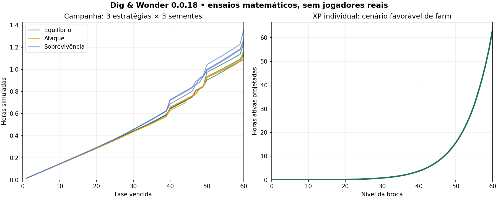

# Brocas como recompensa de fase — 0.0.18

## Regra confirmada pelo usuário

**Vencer fases libera brocas; subir o nível da broca não libera outra personagem.** Vencer a fase 10 concede uma melhor que a inicial; vencer 20, 30, 40, 50 e 60 concede as seguintes. Não há nível geral de jogador ou um segundo XP para essa contagem.

- Cada recompensa começa no **nível 0, XP 0 e sem poderes comprados**.
- A broca anterior conserva XP e poderes; é possível voltar a usá-la.
- Melhorias da oficina continuam compartilhadas. A broca nova aproveita essa estrutura, com bases melhores e padrão próprio.
- A recompensa é gratuita, concedida junto aos prêmios do chefe. Entrar na fase, perder nela ou upar uma broca até 10 não concede a recompensa.
- Repetir um marco não duplica a personagem nem reseta progresso. Perfis existentes recebem os marcos já vencidos ao carregar, preservando o conteúdo anterior.
- Equipar é uma escolha do jogador, entre tentativas. Não muda a personagem no meio de uma rajada ou especial.

## Catálogo jogável provisório

Multiplicadores de ATQ/PV aplicam-se às bases 6/120 antes dos bônus individuais e da oficina. A inicial permanece simples e relativamente fraca; não foram retirados seus níveis ou melhorias existentes.

| Recompensa | Broca | Base ATQ | Base PV | Padrão e característica |
| --- | --- | ---: | ---: | --- |
| Inicial | Pioneira | 1× | 1× | Dois disparos; especial concentrado |
| Vencer fase 10 | Rebite | 1,45× | 1,4× | Dois disparos, chassi e ponta melhores |
| Vencer fase 20 | Centelha | 1,9× | 2× | Três disparos de 80% do dano; cadência +15% |
| Vencer fase 30 | Bastião | 2,75× | 3× | Dois disparos com +20% de dano; cadência −5% |
| Vencer fase 40 | Prisma | 4,5× | 4,7× | Estilhaço inato: um segundo alvo recebe 20% do disparo |
| Vencer fase 50 | Sísmica | 6,8× | 8× | Especial em até três alvos; disparos +15%; cadência −10% |
| Vencer fase 60 | Aurora | 11,5× | 14× | Três tiros de 85%; cadência +10%; especial em dois alvos; estilhaço inato 15% |

A comparação inclui o tempo da rajada, não apenas o número por tiro. No ensaio de casos de troca, as novas brocas nível 0 melhoram a vida e a taxa básica modelada da antecessora nos níveis 11/12/14/17/20/23, respectivamente, sem contabilizar poderes comprados. Uma broca antiga muito mais desenvolvida pode continuar útil; não se apaga seu investimento.

O estilhaço comprado e o inato combinam por `1 − (1 − inato) × (1 − comprado)`, sem ultrapassar 100% do disparo. Ele não gera cadeias. O especial em área aplica dano no mesmo instante do impacto real aos alvos capturados, sem timer visual independente. Se a morte do chefe encerrou a fase, os impactos restantes são cancelados.

**Arte provisória:** todas reutilizam a folha da Pioneira, com cores de identificação e nomes distintos. Existem diferenças funcionais de ataque; ainda não existem sete ilustrações/rigs exclusivos. A identidade visual completa e a revisão das animações continuam pendentes no Editor.

## Dificuldade a cada cinco fases

Há crescimento entre fases e um degrau adicional nas **5, 10, 15…60**. Trocar para uma broca nível 0 não reduz a dificuldade, porque ela pertence à fase.

```text
degrau = floor(fase / 5)
PV comum = 24 × 1,115^(fase−1) × 1,12^degrau
Dano comum = 4 × 1,10^(fase−1) × 1,08^degrau
PV chefe = 8 × PV comum
Dano chefe = 1,5 × dano comum
```

Em uma passagem normal de fase, a vida cresce 11,5% e o dano 10%. Em um marco de cinco, a combinação resulta em **24,88% de vida e 18,8% de dano** em relação à fase anterior. Ouro, cristais de primeira vitória, treino e baús continuam seguindo a economia existente. O chefe continua sendo o único requisito de avanço.

## XP por fase e por personagem

Para a fase `F`, usando base 10 no comum e 60 no chefe:

```text
XP por inimigo = max(ceil(base × 1,035^(F−1)), base + F−1)
XP para próximo nível da broca L = ceil((20 + 12 × L) × 1,125^L)
```

O piso de um ponto adicional impede empates por arredondamento: cada fase paga mais XP por inimigo que a anterior. Não há transferência de XP entre brocas.

| Fase | XP comum | XP chefe |
| --- | ---: | ---: |
| 1 | 10 | 60 |
| 10 | 19 | 82 |
| 20 | 29 | 116 |
| 30 | 39 | 163 |
| 40 | 49 | 230 |
| 50 | 59 | 324 |
| 60 | 77 | 457 |

Exemplo: a Centelha recebida na vitória da fase 20 começa zerada. Ao entrar na fase 21, recebe **30 XP** por comum e o XP correspondente do chefe, permitindo recuperar os primeiros níveis rapidamente. Os níveis altos continuam caros: nível 30 exige 75.231 XP acumulados, 50 exige 1.479.788 e 60 exige 5.929.420.

O teto 60 é opcional para cada broca; não se exige desenvolver a Pioneira até ele antes de trocar. O cenário artificialmente favorável de Aurora na fase 60, com toda a oficina e poderes no máximo desde o início, projeta **63,445 horas ativas** para uma personagem do 0 ao 60 por ciclos medidos. Isso não é tempo humano medido; fases futuras, novas brocas, buffs ou mudanças de XP podem mudar o ritmo.

## Como acessar

1. Vença um marco. A tela de vitória informa a broca liberada.
2. Abra **Personagem → Brocas**, ou volte ao Acampamento e abra **Garagem**.
3. Use as setas para consultar o catálogo. Ao abrir a Garagem, ela destaca a recompensa possuída mais recente.
4. Entre tentativas, toque **Equipar**. A vitrine, XP, nome e cores passam para a selecionada. Na tentativa seguinte, seus atributos/padrões entram em combate.
5. Consulte **Oficina/Poderes/Tesouro** para as compras existentes. Abrir o menu durante a luta continua pausando e salvando a mesma tentativa; trocar de broca exige encerrar a tentativa.

## Sistemas e save

- `Economy/midgame.json`: catálogo, multiplicadores, padrões, cores, marcos e degraus de dificuldade; também é lido pelos ensaios.
- Sete `CharacterDefinition` ScriptableObjects em `Resources/Data/Characters`: identificam as personagens implementadas e a curva de XP. O carregamento rejeita catálogo incompleto.
- `CharacterProgression.GrantStageRewards`: concessão idempotente baseada em `HighestClearedStage`.
- `IdleCombatSimulation`: resolve a personagem da tentativa, seus padrões, escalas e recompensa atômica do chefe.
- `AutoBattleDriver`: valida concessões, salva equipagem e reconciliação, encaminha os eventos para UI.
- `CharacterWorkshopView` e `PrototypeGameUI`: garagem, vitrine, identificação, faixa de ameaça e aviso de recompensa. Nenhuma colisão ou posição lógica foi animada.

O formato de save permanece no **esquema 3**, pois ele já guardava IDs, XP, poderes e fase vencida. Não há novo campo de perfil necessário. O arquivo antigo é preservado pelo fluxo de backup; desbloquear uma broca não modifica os pontos da anterior. Projetos antigos que não conhecem uma broca equipada bloqueiam o carregamento, preservando o arquivo.

## Validação executada

- **74 checks de domínio aprovados**, incluindo os 61 da economia anterior e 13 casos novos: marcos 10–60, distinção de nível/fase, recompensas completas antes do save/eventos, repetição, recuperação de marcos em perfis anteriores, troca vantajosa nos casos modelados, rajada de três tiros, estilhaço inato, especial em três alvos, XP/dificuldade e retomada de outra broca com projéteis.
- C# compilou com **zero erros e avisos** contra stubs e DLLs reais do Unity 6000.0.23f1.
- Referências e GUIDs dos sete ScriptableObjects conferidos por leitura de arquivos.
- Tentativa real de Editor em `-batchmode -nographics -quit` bloqueada antes da importação: `No valid Unity Editor license found`.
- Não houve Play Mode desta versão, gravação, revisão visual da UI em runtime, novo APK ou medição de FPS Android.

### Ensaios de progressão com trocas

Três políticas de compra × três sementes, no núcleo C# real. Os compradores equipam a recompensa mais recente após encerrar a tentativa, preservam a coleção, abrem baús e usam treino após derrota. Compras de cristais e anúncios não participam.

| Política | Tempo até a fase 60 | Nível da Sísmica que venceu a 60 |
| --- | ---: | ---: |
| Equilíbrio | 67,78–74,10 min simulados | 19–20 |
| Ataque | 65,40–70,36 min simulados | 19–20 |
| Sobrevivência | 74,64–81,72 min simulados | 19–21 |

**Fase 60 não é personagem nível 60.** Ao concluir o catálogo, Aurora é concedida no nível 0. A campanha deste protótipo está rápida para compradores automáticos; estes números não demonstram diversão, retenção, ritmo humano ou suficiência de conteúdo para dezenas de horas. Antes de expandir a campanha, testar pausas para compras, satisfação nas trocas, duração de fases e momentos sem recompensa em partidas reais.

Um caso de equilíbrio, semente 12345:

| Marco vencido | Tempo simulado | Broca usada e nível | Recompensa, sempre nível 0 |
| --- | ---: | --- | --- |
| 10 | 8,64 min | Pioneira 11 | Rebite |
| 20 | 17,30 min | Rebite 12 | Centelha |
| 30 | 26,54 min | Centelha 14 | Bastião |
| 40 | 38,85 min | Bastião 16 | Prisma |
| 50 | 54,19 min | Prisma 18 | Sísmica |
| 60 | 67,78 min | Sísmica 19 | Aurora |



CSV: [campanha](balance/campaign-0.0.18.csv), [XP individual](balance/character-xp-0.0.18.csv), [custos](balance/upgrade-costs-0.0.18.csv), [nove simulações](balance/simulation-0.0.18.csv), [projeção de XP longo](balance/long-term-xp-0.0.18.csv).

Reprodução pela raiz: `source scripts/unity-env.sh` na nuvem; `dotnet run --project UnityProject/Tools/DomainChecks/DomainChecks.csproj`; depois `dotnet run --project UnityProject/Tools/DomainChecks/DomainChecks.csproj -- --economy-report` e `python3 scripts/plot-economy.py`.

### Roteiro pendente no Unity/aparelho

Em perfil de teste, verificar vitória/derrota no marco 10, abertura da Garagem, botão bloqueado antes da vitória, XP 0 da recompensa, equipagem entre tentativas, retorno à anterior e persistência após reabrir. Conferir visualmente três disparos, número de alvos do especial, identificação por cor, legibilidade e área segura. Fazer testes reais de toque, suspensão/retomada e desempenho no Android. Nenhum comando de teste modifica o save pessoal: os checks usam diretórios temporários e perfis de simulação.
