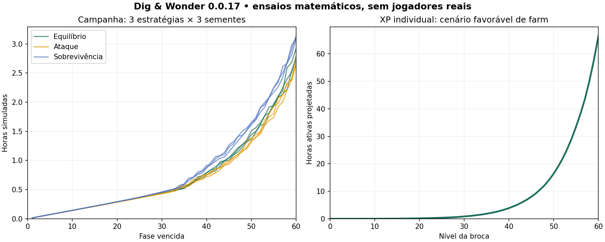

# Economia, XP e progressão — 0.0.17

## Decisões e alcance

> Direção adicional solicitada após o ensaio: broca inicial deliberadamente fraca, novas brocas a cada dez níveis e degraus de dificuldade a cada cinco. Este checkpoint registra a base monetária funcional; a escolha entre contagem geral contínua ou dez níveis de cada broca está em esclarecimento. O nível 60 não será requisito para trocar a broca inicial. O ritmo de desbloqueios e a força de cada broca precisam entrar no próximo ensaio.

Esta é a primeira tabela autoral de balanceamento Unity, solicitada pelo usuário em 20/10/2026. Não representa paridade com os números históricos do Godot. A correção posterior do usuário foi incorporada: **nível 60 da broca deve demorar bastante**, com referência inicial de **60–100 horas ativas por personagem**. Essa referência é hipótese de design, não tempo de jogadores medido.

- **Nível da broca:** individual, começa em 0, teto inicial 60; conserva XP e poderes ao trocar. Uma personagem nova não herda esses dois progressos.
- **Fase da campanha:** encontro numerado de 1 a 60, independente do nível da broca. Reutiliza os biomas existentes e seus chefes; não são 60 cenários inéditos.
- **Oficina:** sete melhorias compartilhadas, com ouro. Requisitos usam o maior nível entre personagens possuídas, para uma nova broca não bloquear a oficina já desenvolvida.
- **Poderes:** quatro especializações compradas com ouro e guardadas em cada personagem. Requisitos usam o nível daquela broca.
- **Treino:** repete a última fase vencida entre tentativas, sem perder a maior fase e sem repetir bônus de primeira vitória.

O primeiro passe chegava ao nível 53 em cerca de duas horas, rápido demais. A curva final exige **5.929.420 XP** para 60. No cenário favorável descrito abaixo, o cálculo por ciclos de combate medidos projeta **66,5 horas ativas**, começando artificialmente com todas as melhorias e poderes no máximo. A aquisição normal desses recursos e o avanço inicial acrescentam tempo.

## Pesquisa aplicada

- [Anthony Pecorella — The Math of Idle Games, Kongregate](https://www.kongregate.com/en/pages/the-math-of-idle-games-part-i): compara crescimento de custos, produção e multiplicadores; apresenta modelagem em planilhas. Aplicação nossa: preços exponenciais, cálculo do ganho marginal por custo e comparação de estratégias em simulação. Os percentuais deste jogo foram definidos aqui, não copiados de outro jogo.
- [Unity — Building an in-game economy](https://unity.com/how-to/building-game-economy-guide-part-2): recomenda mapear recursos, fontes, gastos e sua relação com progresso. Aplicação nossa: fontes e destinos explícitos por moeda, aquisição de força pelo jogo e avaliação do saldo por faixa da campanha.
- [Machinations — Drains](https://machinations.io/docs/drains): recursos consumidos saem da economia. Aplicação nossa: ouro, cristais e chaves são debitados na mesma transação da compra/abertura; não há venda ou conversão inversa que crie um ciclo de lucro.

Essas referências orientam o método. Elas não comprovam retenção, diversão ou adequação dos nossos números.

## Moedas e inventário

Perfil novo começa com **0 ouro, 0 cristais, 0 chaves e 0 baús**. Tentativas e treino são gratuitos; derrotas conservam o que foi ganho.

| Recurso | Entradas | Gastos |
| --- | --- | --- |
| Ouro | Inimigos, chefes, baús, reserva por cristais | Sete melhorias e quatro poderes |
| Cristais | 5 por primeira vitória em cada fase; +20 a cada cinco fases; baús | Chave por 10; reserva de ouro por 20 |
| Chave | Uma por chefe; compra opcional por cristais | Uma por baú aberto |
| Baú | Um por chefe, inclusive em treino | Abertura com chave |

As 60 primeiras vitórias entregam **540 cristais garantidos** no total. Repetir a mesma fase não repete esse prêmio; chefe, ouro, XP, baú e chave continuam disponíveis. A reserva custa 20 cristais e entrega `20 × ouro do inimigo comum da maior fase vencida`; antes da primeira vitória usa a fase 1. Uma chave extra atende também inventários legados com baús excedentes; não é obrigatória para abrir os baús novos, pois cada chefe entrega uma chave.

Não há dinheiro real, compra de XP ou anúncio necessário nesta tabela. Saldo usa inteiros de 32 bits; transações de gasto rejeitam overflow sem consumir recursos. Créditos de combate respeitam o limite numérico, preservando o saldo existente.

### Baús e probabilidades

A categoria é sorteada na abertura, com estado de sorte persistido. Não há equipamentos inventados dentro deste baú: ele entrega ouro/cristais; a coleção de peças ainda está pendente.

| Categoria | Chance | Ouro | Cristais |
| --- | ---: | ---: | ---: |
| Comum | 70% | 8 × ouro comum da origem | 0 |
| Raro | 23% | 14 × ouro comum da origem | 2 |
| Épico | 6% | 24 × ouro comum da origem | 5 |
| Lendário | 1% | 40 × ouro comum da origem | 12 |

Valor esperado: **10,66 × ouro comum da origem + 0,88 cristal**. Guardar o baú não aumenta seu valor: a fase de aquisição é persistida em pilhas, sem um objeto visual por item. Baús antigos sem procedência preservam a quantidade e usam fase 1. As chances somam 10.000 pontos de base; não há proteção de sorte ou promessa de lendário nesta versão.

## XP e níveis individuais

Para o nível atual `L`, de 0 a 59:

```text
XP necessário para o próximo = ceil((20 + 12 × L) × 1,125^L)
XP comum na fase F = ceil(10 × 1,035^(F−1))
XP chefe na fase F = ceil(60 × 1,035^(F−1))
```

Só derrotar inimigos concede XP; causar dano, abrir baús, reabrir o app ou passar tempo fora dele não concede XP. Excedente passa para o próximo nível. No teto, para de conceder XP novo, sem reduzir pontos já armazenados. Não existe XP de conta transferível entre personagens.

| Nível alcançado | XP acumulado necessário |
| --- | ---: |
| 0 | 0 |
| 10 | 1.539 |
| 20 | 13.535 |
| 30 | 75.231 |
| 40 | 349.443 |
| 50 | 1.479.788 |
| 60 | 5.929.420 |

Cada nível individual adiciona **2% do dano base** e **3% da vida base**, antes do multiplicador de oficina. Assim, a personagem nível 60 tem multiplicadores individuais de 2,2× de dano e 2,8× de vida. Subir de nível ou melhorar blindagem adiciona apenas a diferença de vida máxima à vida atual, não uma cura completa repetível.

## Melhorias da oficina

O nível comprado inicia em 0. O próximo preço é `ceil(preço inicial × crescimento^nível comprado)`. Cada clique compra um nível. Bônus de categorias diferentes multiplicam entre si conforme as fórmulas seguintes.

| Melhoria | Libera no nível | Preço inicial | Aumento do preço | Máximo | Efeito por nível |
| --- | ---: | ---: | ---: | ---: | --- |
| Ataque | 0 | 18 | 10,5% | 100 | Dano ×1,055 |
| Blindagem | 0 | 20 | 10% | 100 | Vida ×1,055 |
| Especial | 3 | 70 | 14% | 30 | +10% do especial base; até 4× |
| Chance crítica | 5 | 90 | 15% | 30 | +1 ponto percentual; de 5% a 35% |
| Cadência | 8 | 100 | 16% | 25 | +2% da cadência base; até +50% |
| Dano crítico | 10 | 120 | 14% | 30 | +0,05×; de 1,5× a 3× |
| Autorreparo | 12 | 140 | 18% | 10 | +0,1% da vida máxima/s; até 1%/s |

Críticos aplicam-se aos disparos básicos; o especial tem sua própria melhoria. Cadência acelera o ciclo e o intervalo entre os dois disparos, preservando o dano por tiro e o tempo de viagem. Autorreparo acontece só em combate ativo e depende do tempo simulado, não de frames.

## Poderes de ataque por broca

Todos são passivos, cumulativos e têm **cinco ranks**, começando no rank 0. São comprados na aba Poderes; não exigem um novo botão ou timer visual de habilidade.

| Poder | Nível individual | Primeiro rank | Aumento do preço | Efeito por rank | Rank 5 |
| --- | ---: | ---: | ---: | --- | --- |
| Dentes de titânio | 2 | 80 ouro | 65% | +3% nos disparos | +15% |
| Ressonância de cristal | 5 | 140 ouro | 70% | +8% no especial | +40% |
| Quebra-guardiões | 10 | 260 ouro | 75% | +6% contra chefes | +30% |
| Estilhaço magnético | 15 | 420 ouro | 80% | Outro alvo recebe 15% do disparo | 75% em um segundo alvo |

Estilhaço precisa de outro inimigo vivo, não rebate no mesmo alvo nem gera uma cadeia de impactos. O impacto secundário é instantâneo junto ao impacto principal e usa o feedback já existente. Se o projétil perdeu seu alvo antes de chegar, não gera estilhaço ou recompensa. Especial mantém quatro impactos no alvo marcado; golpes restantes não migram automaticamente após sua morte.

### Fórmulas de combate

```text
Dano normal = 6 × 1,055^Ataque × (1 + 0,02 × nível da broca)
PV máximo = 120 × 1,055^Blindagem × (1 + 0,03 × nível da broca)
Disparo = dano normal × (1 + 0,03 × rank Dentes)
Crítico básico = disparo × (1,5 + 0,05 × DanoCrítico)
Chance crítica = 0,05 + 0,01 × ChanceCrítica
Especial total = 32 × (dano normal / 6) × (1 + 0,10 × Especial)
                 × (1 + 0,08 × rank Ressonância)
Contra chefe: multiplicar dano por (1 + 0,06 × rank QuebraGuardiões)
Cadência = 1 + 0,02 × nível Cadência
```

O crítico é sorteado no lançamento e fica salvo com o projétil; dano básico e autoria não são recalculados ao reabrir o jogo. Bônus contra chefe e estilhaço são avaliados no impacto. As animações respondem aos eventos existentes; não há mudança de colisão ou novo estado visual para acomodar esses cálculos.

## Campanha e recompensas

Para a fase `F` entre 1 e 60:

```text
PV comum = 24 × 1,115^(F−1)
Dano comum = 4 × 1,10^(F−1)
PV chefe = 8 × PV comum
Dano chefe = 1,5 × dano comum
Ouro comum = ceil(8 × 1,07^(F−1))
Ouro chefe = 10 × ouro comum
```

Oito ondas, separadas por sete segundos; as primeiras cinco trazem um inimigo e as demais dois. O chefe aparece com a última onda. Inimigos/baús não precisam ser esgotados para avançar: o requisito continua sendo derrotar o chefe. Mantêm-se os limites de entidades/projéteis e a chance de 22% de usar a região surpresa após um chefe normal. Nenhum prêmio de primeira vitória depende desse sorteio de bioma.

| Fase | PV comum | PV chefe | Ouro comum | XP comum/chefe |
| --- | ---: | ---: | ---: | ---: |
| 1 | 24 | 192 | 8 | 10 / 60 |
| 10 | 63,93 | 511,42 | 15 | 14 / 82 |
| 20 | 189,86 | 1.518,88 | 29 | 20 / 116 |
| 30 | 563,87 | 4.511,00 | 57 | 28 / 163 |
| 40 | 1.674,68 | 13.397,42 | 112 | 39 / 230 |
| 50 | 4.973,70 | 39.789,61 | 221 | 54 / 324 |
| 60 | 14.771,63 | 118.173,04 | 434 | 77 / 457 |

Ao vencer a 60, o perfil fica nessa faixa para treino e futuras expansões. Não começa uma fase 61 sem conteúdo. O médio prazo desta amostra é a faixa 30–60 da campanha e aproximadamente nível 20–32 individual; o teto individual 60 é um objetivo distante.

## Ensaios executados

O programa usa `IdleCombatSimulation`, a mesma lógica do jogo. Lê os números dos assets convertidos e a tabela ativa, em vez de manter uma segunda fórmula de combate. Três políticas de compra (equilíbrio, ataque e sobrevivência), cada uma com três sementes; compras verificadas a cada dois segundos, no máximo cinco por consulta. Após derrota, usam treino; abrem baús entre tentativas. Cristais não são gastos, anúncios não participam.

| Estratégia | Tempo até fase 60, três sementes | Nível da broca ao chegar |
| --- | ---: | ---: |
| Equilíbrio | 163,21–175,31 min simulados | 32 |
| Ataque | 159,24–166,76 min simulados | 32 |
| Sobrevivência | 185,80–188,23 min simulados | 32 |

**XP longo:** simula um ciclo real de farm na fase 60 em cada faixa de nível e projeta quantos ciclos iguais seriam necessários para o próximo. Todas as melhorias e poderes começam no máximo, cenário artificialmente favorável; não se simularam 66 horas passo a passo nem sessões humanas. A projeção resultou em **66,512 h para o nível 60**. Um check adicional calcula o limite ideal de XP por ciclo usando todas as mortes e chefe instantâneo após a última onda: mesmo esse orçamento exige mais de 60 h para os 5.929.420 XP, sob as regras atuais de ciclos completos.



Dados reproduzíveis:

- [Fases e recompensas](balance/campaign-0.0.17.csv).
- [Todos os níveis de XP](balance/character-xp-0.0.17.csv).
- [Custos e totais das melhorias](balance/upgrade-costs-0.0.17.csv).
- [Tentativas das nove simulações](balance/simulation-0.0.17.csv).
- [Projeção por ciclos medidos para XP longo](balance/long-term-xp-0.0.17.csv).

## Persistência e arquitetura

- `EconomyDefinition` é o ScriptableObject de entrada e referencia `Resources/Data/Economy/midgame.json`. A curva de XP da Pioneira aponta para ele. JSON é o conteúdo comum a runtime e ensaios; o importador histórico do Godot não o substitui.
- `EconomyProgression` guarda fórmulas e transações em C# puro; `IdleCombatSimulation` integra dano, XP, prêmios e término de fase. `AutoBattleDriver` mantém a persistência e os pontos de entrada. UI consulta esses dados e encaminha operações.
- Save Unity **3** acrescenta cristais, campanha, ranks por personagem, procedência dos baús e estado de sorteio. Esquemas 1/2 migram em memória; a primeira gravação guarda os bytes antigos no backup. Ouro, quantidades, níveis de oficina, personagem e XP acumulado são preservados. Como a versão anterior não tinha campanha absoluta, a faixa numérica inicia em 1; seu ID de bioma é conservado. Baús antigos mantêm quantidade e usam recompensa da fase 1.
- O nível é derivado do XP pela nova curva; um perfil antigo pode exibir nível menor, sem perder XP acumulado. Isso é mudança deliberada de balanceamento. Não existe conversão retroativa para conceder milhões de pontos.
- Os prêmios de chefe ficam completos antes de emitir eventos: ouro, XP, chave, baú, cristais, maior fase e próximo encontro. Encerrar combate limpa ações antes de outro dano pendente.
- Compras/aberturas salvam imediatamente; recompensas são salvas após o passo, além do autosave de cinco segundos e pausa/saída. Checksum, backup e temporário continuam ativos. Falha de escrita bloqueia combate e novas compras enquanto tenta gravar novamente. Uma versão futura íntegra não é substituída por backup antigo.

## Verificação e como jogar

**Checks de domínio:** 61 aprovados, incluindo os 39 anteriores. Casos novos cobrem preços, limites, requisito/saldo, XP até 60, orçamento de horas, quatro poderes em combate, crítico/cadência/reparo, prêmios únicos, treino, baús sem inflação por espera, 100 mil sorteios, overflow, migração e retomada determinística de projéteis/XP/carteira.

**Compilação C#:** projetos com stubs e contra DLLs reais do Unity 6000.0.23f1. Isso não valida importação de assets, grafo UPM ou execução no Editor. A tentativa real `-batchmode -nographics -quit` parou antes da importação: `No valid Unity Editor license found`. Não há novo APK ou Play Mode desta versão.

Para conferir no PC com licença ativa:

1. Abra `UnityProject` no Unity 6000.0.23f1, aguarde importação e abra `Assets/_Game/Scenes/Prototype.unity`.
2. Entre em Play. Em um perfil novo, use **Iniciar escavação**; com perfil existente, confira a retomada.
3. Abra **Personagem/Melhorias**. Na Oficina, use as setas para ver sete melhorias e seus requisitos; compre uma, observe saldo/atributo e reabra o app.
4. Na aba Poderes, confira requisitos individuais e compre Dentes quando o nível permitir. Compare o dano dos disparos; mais tarde teste os outros poderes e dois alvos para Estilhaço.
5. Derrote um chefe. Confira ouro/XP, um baú/chave e primeira vitória. Abra **Baús/Tesouro** e consuma um baú/chave. Reabra e confirme que não reaparece nem muda de prêmio.
6. Entre tentativas, volte ao Acampamento e use **Treino**. Maior fase fica guardada; vencer a repetição não paga os cristais de primeira vitória novamente.
7. Confira paginadores, textos longos, área segura e retorno do menu em retrato pequeno. No Android, validar toque, pausa/retomada, armazenamento e uso de memória/CPU/GPU.

**Limites:** nenhum teste de jogador real, gravação de runtime ou revisão visual desta interface nova foi possível no Unity. O gráfico é de dados, não imagem do jogo. Não há alegação de FPS Android. O APK local antigo e o smoke test anterior de 10 s não validam este balanceamento. XP offline, anúncios, compras reais, equipamentos colecionáveis, novos personagens jogáveis e conteúdo posterior ao marco continuam pendentes; a estrutura atual não implementa esses sistemas por tabela.
