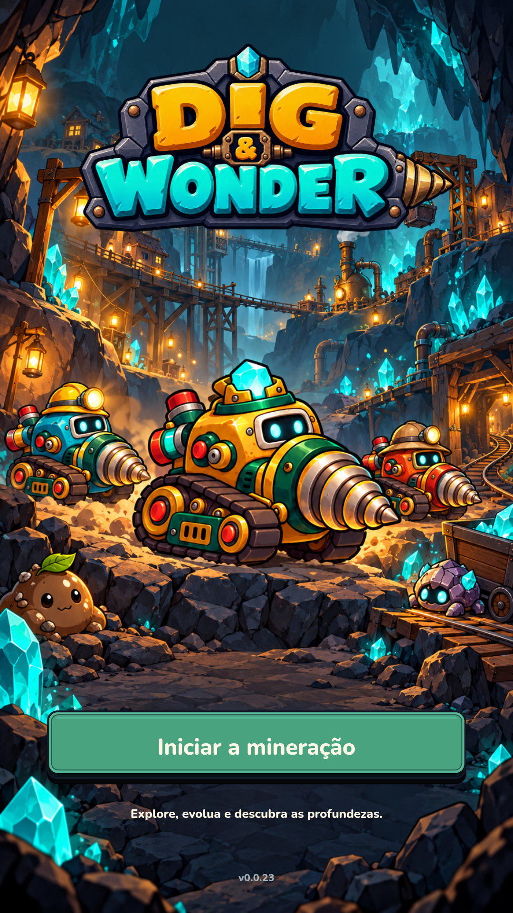

# Menu inicial e mineração contínua — 0.0.23

Pedido do usuário em 21/10/2026: substituir o Acampamento por **abrir → Iniciar a mineração → combate**. Ao vencer uma fase, continuar no jogo e passar para o próximo mapa. A logo foi aprovada explicitamente após engrossar e reduzir o “&”.

## Arte entregue

- `UnityProject/Assets/_Game/Resources/Art/StartMenu/dig-and-wonder-logo-v3.png`: logo aprovada, PNG RGBA 1774×887, sem alterações posteriores à aprovação.
- `UnityProject/Assets/_Game/Resources/Art/StartMenu/mine-start-v1.png`: ilustração vertical 941×1672, sem texto. Pioneira no centro, duas variantes de cor com chapéus, Gosma de Terra, Besouro Pedra, cristais, casas de mineiros, passarelas, guindaste, elevador e máquina a vapor.
- Botão, rótulo, mensagem de save e versão são elementos uGUI/TMP separados. O botão usa Nunito derivada (`DWRounded-ExtraBold`), pintura verde e feedback de pressão reaproveitado da Oficina. A área de toque não se move.
- Fundo preenche a tela; logo e controles são filhos de `Start safe area`, usando o `SafeAreaFitter` existente. Texturas importadas como Sprite Single, bilinear, sem mipmaps, sem leitura por CPU. A ilustração é estática neste marco.

As variantes da ilustração são decorativas; não representam uma concessão de skin, personagem ou buff. Os inimigos da arte não alteram os spawns do combate.

Proveniência: logo e ilustração produzidas com a ferramenta de geração de imagens nesta conversa, segundo `IDENTIDADE-TOY-MECHA.md`. A folha `Art/Drill/drill_pioneira.png` foi usada como referência da protagonista. A composição segue uma direção própria; a imagem de Legend of Slime fornecida pelo usuário serviu como referência de tela inicial. Moldura do botão e fontes são os recursos já existentes, com as licenças preservadas no projeto.

## Fluxo implementado

1. O bootstrap carrega o perfil e monta a interface com o driver pausado. Mesmo quando há uma tentativa carregada, não há avanço do relógio de combate atrás do menu inicial.
2. **Iniciar a mineração** retoma a tentativa ativa ou cria a tentativa correspondente ao perfil. O botão fica indisponível se o driver não estiver pronto, com mensagem de erro de save/conteúdo sem sobrescrever progresso inválido.
3. O boss concede as recompensas pelo simulador existente. O driver encerra o passo e salva; a interface exibe a vitória durante 1,8 s de apresentação.
4. A continuação automática confirma o save antes de iniciar a fase seguinte. Não ocorre dentro do callback de dano/vitória; evita reentrância na transação. Falha de gravação bloqueia o avanço e mantém a recuperação existente.
5. O cenário acompanha o `StageId` real: Prado Cristalino, Gruta Basáltica e Jardim Fóssil usam suas ilustrações já presentes no repositório. Fenda Aurora usa provisoriamente a gruta com tonalidade violeta. O ciclo/aleatoriedade de mapas continua sendo o existente; não há cem cenários distintos.
6. Oficina e Baús abrem pela navegação, pausam a tentativa e retornam ao jogo ao fechar. Abrir a Oficina durante a apresentação de vitória adia o avanço até fechar. A coleção continua na aba Brocas da Oficina, com troca permitida entre tentativas.
7. Derrota mostra **Recomeçar** no próprio combate. Fase 100 concluída não inicia uma fase 101 nem repete automaticamente a última fase; mantém Oficina e repetição manual.

O save continua no esquema 3. Custos, dano, vida, cooldown, XP, drops, baús, chaves e brocas por marco não foram recalibrados por esta alteração de apresentação. O estado AUTO durante a sessão é preservado ao continuar a fase e ao fechar a Oficina.

## Validação executada

| Verificação | Resultado | Limite |
| --- | --- | --- |
| DomainChecks | 78 checks aprovados | Núcleo C#, sem Editor |
| Continuação elegível | Vitória completa permite avançar; tentativa ativa, derrota, vitória antiga e perfil ausente rejeitados | Validação da regra usada pelo driver |
| Vitória 10 → fase 11 | Novo mapa, Rebite, ouro, XP, baú, chave e cristais preservados; save antes/depois da transição reaberto; repetição da vitória antiga rejeitada | Transação e persistência reais em pasta temporária |
| Fase 100 | Vitória e Singular preservadas; continuação automática rejeitada | Núcleo, sem interação visual |
| UnityCompileCheck | Compilação sem erros/avisos | Stubs, não executa Unity |
| UnityApiCompileCheck | Compilação sem erros/avisos | DLLs do Unity 6000.0.23f1/template; não confirma importação no 6000.6.6f1 |
| Composição | PNGs e Nunito compostos em Chromium; revisadas 1080×1920 e 390×844; capturas também em 360×640 e 360×800 | Prévia externa, não é captura do jogo |
| Batch do Editor vigente | Bloqueado: executável 6000.6.6f1 não instalado nesta nuvem | Tentativa via `scripts/unity-editor.sh`; Editor antigo disponível não foi usado para regravar projeto novo |
| Play Mode/Android/APK desta versão | Pendente | Exige Editor vigente licenciado; toque e desempenho exigem aparelho |

Logs locais: `.tools/logs/start-menu-domain.log`, `start-menu-compile-stubs.log`, `start-menu-compile-real-api.log` e `start-menu-editor-batch.log`. A evidência local anterior em `PLAYMODE-LOCAL-2026-10-20.md` não valida as mudanças desta versão.

## Prévia para revisão

Reproduzir a prévia: `python3 scripts/preview-start-menu.py --capture`. Requer Playwright/Chromium; gera somente arquivos em `.tools/review/start-menu`. A saída é uma aproximação das âncoras, fonte e sprites do menu; não comprova shader, raycast, safe area física ou renderização TMP do jogo.

## Roteiro pendente no Unity

1. Abrir `UnityProject` com o Editor indicado em `ProjectVersion.txt`; aguardar importação e conferir Console.
2. Abrir `Assets/_Game/Scenes/Prototype.unity`, Play e confirmar logo/fundo/botão. Esperar alguns segundos sem clicar e conferir que o combate não avança.
3. Iniciar, fechar/reabrir e confirmar que o menu aparece e o botão retoma o mesmo perfil. Usar perfil de teste separado; preservar o perfil pessoal.
4. Vencer uma fase: ver recompensa e próximo mapa sem título/acampamento. Conferir baú/chave uma vez só. Abrir/fechar Oficina na vitória e durante combate.
5. Conferir derrota/recomeço e encerramento na fase 100. Testar mouse/toque, rolagem, alturas de tela e ausência de efeitos antigos após transição.
6. Gerar APK somente após importação/Play Mode; instalar em aparelho para conferir legibilidade, safe area e medir desempenho. Nenhuma medição Android foi feita nesta entrega.
