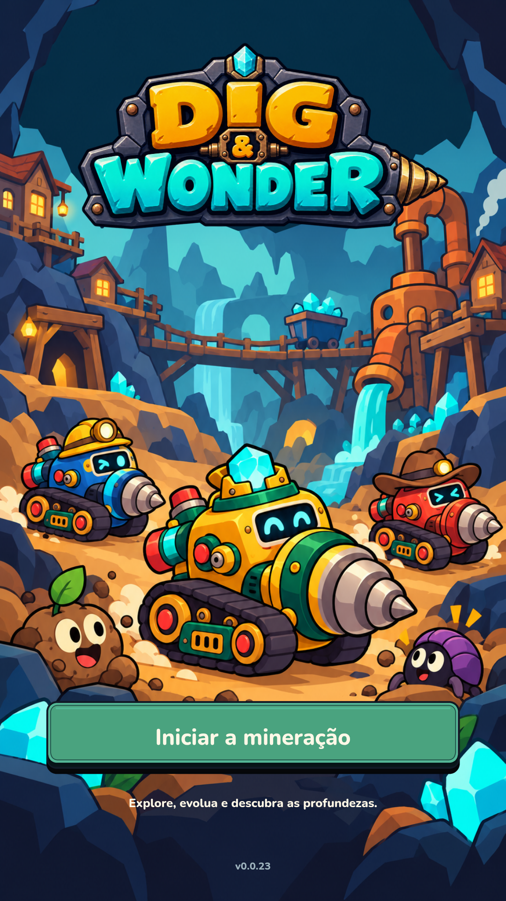

# Menu inicial — proposta visual v2

**Estado: em revisão pelo usuário.** A arte de produção continua sendo a v1 da versão 0.0.23 até a escolha desta proposta. A logo v3 aprovada foi preservada exatamente.

O usuário considerou a primeira arte artificial. Esta proposta reduz os detalhes de rochas e máquinas, os reflexos metálicos e o excesso de elementos no fundo. Usa contornos maiores, cores em áreas amplas, sombras simples, variantes com expressões diferentes e inimigos mais expressivos.

- `mine-start-v2.png`: ilustração gerada a partir da folha da Pioneira, sem logo ou texto embutidos. Fundo e personagens redesenhados com direção cartoon mais gráfica.
- `preview-1080x1920.png`: composição de revisão em Chromium, com a logo aprovada, botão e fonte existentes. **Não é captura do Unity.**

Não foram alterados código de gameplay, save, recursos carregados pelo Unity ou balanceamento nesta proposta. A integração será feita depois da revisão visual.

