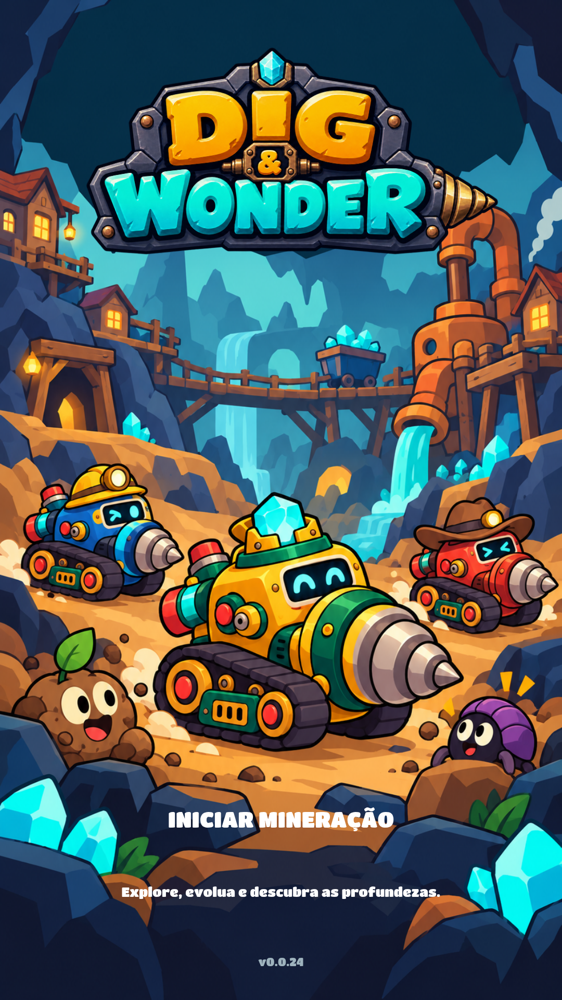
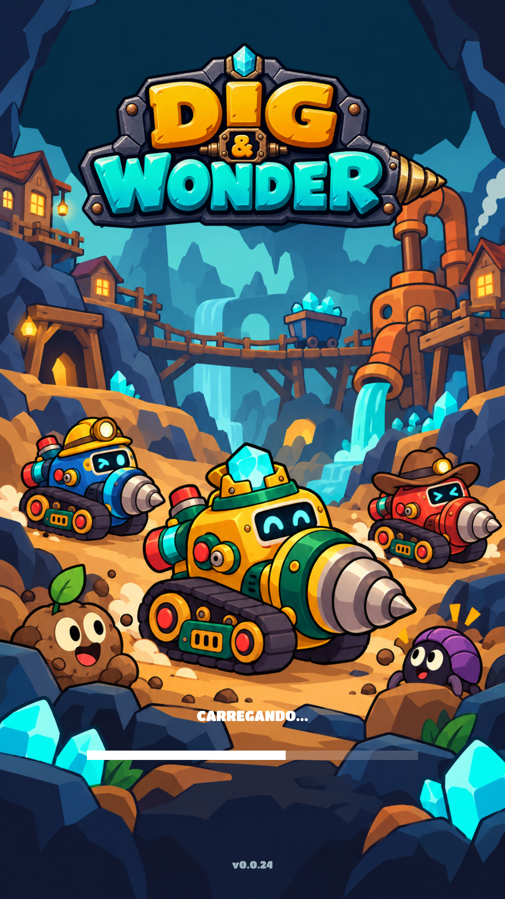

# Menu inicial — ação branca e carregamento — 0.0.24

Nova composição pedida pelo usuário: **INICIAR MINERAÇÃO** em branco, sem fundo, com fonte grossa em tamanho moderado. Titan One aproxima a linguagem das letras da logo; a logo em si é arte personalizada e permanece intacta. Enquanto os recursos são preparados, o lugar da ação é ocupado por **CARREGANDO...** e uma barra branca.

O fundo é a arte cartoon v2. Logo, texto, barra e área clicável continuam elementos separados.

- `preview-ready.png`: estado pronto, com a ação disponível.
- `preview-loading.png`: estado de carregamento ilustrado em 60% para revisar a composição. Esse valor não é uma medição de tempo ou volume de dados.
- `preview-390x844.png`: composição alongada, com margens de área segura simuladas.

As capturas são prévias HTML/Chromium usando PNGs/fontes reais. **Não executam o Unity e não comprovam comportamento do carregamento.** A integração e a verificação técnica estão em [CARREGAMENTO-INICIAL.md](../../CARREGAMENTO-INICIAL.md).

