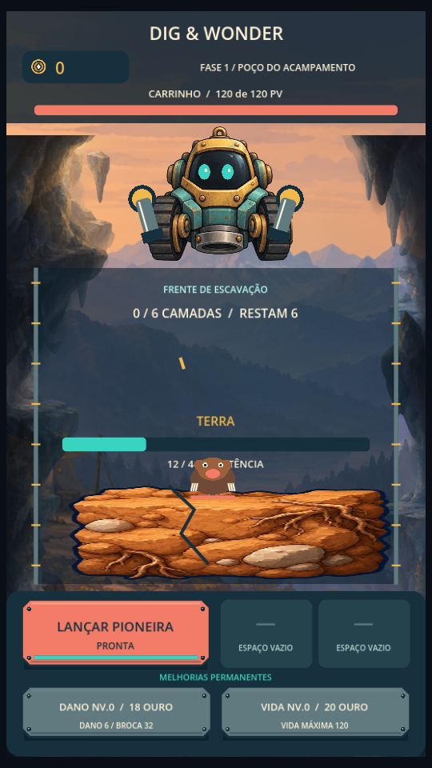
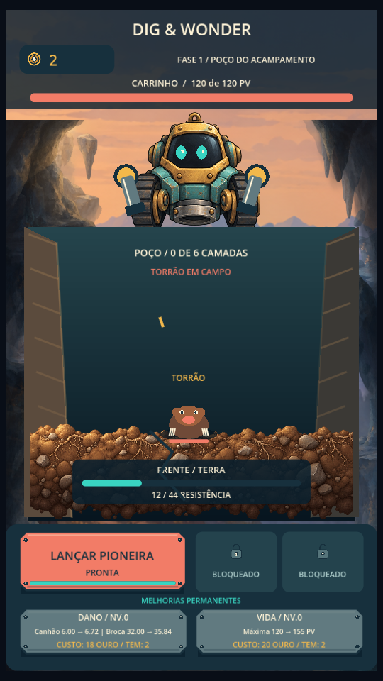
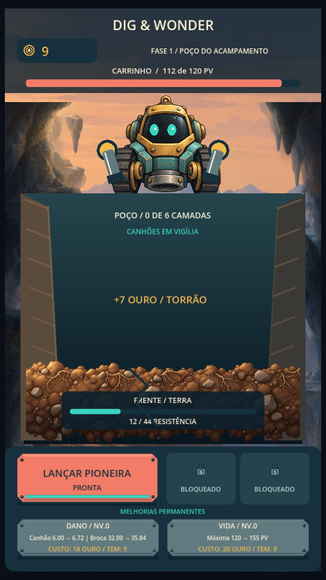
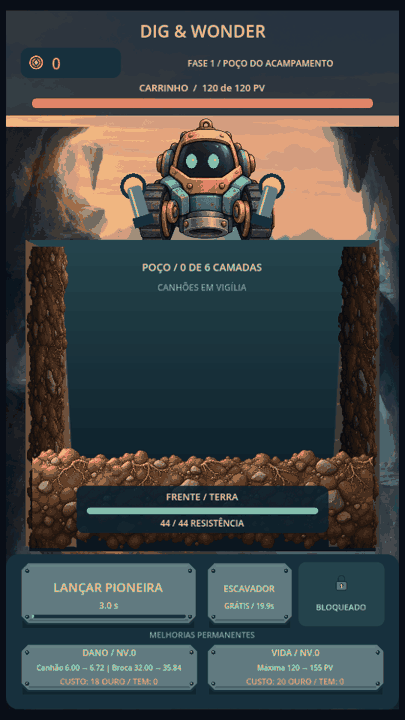
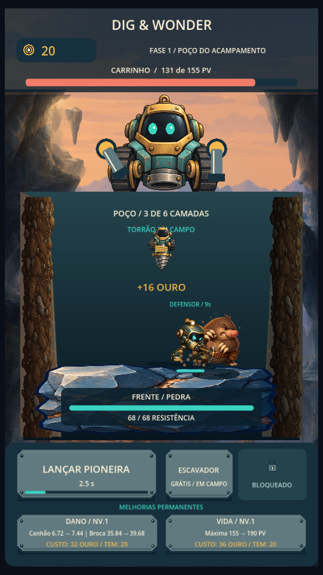
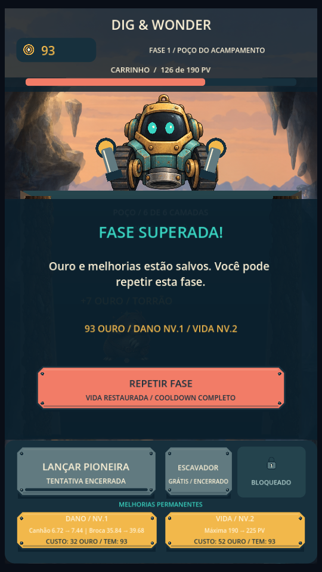
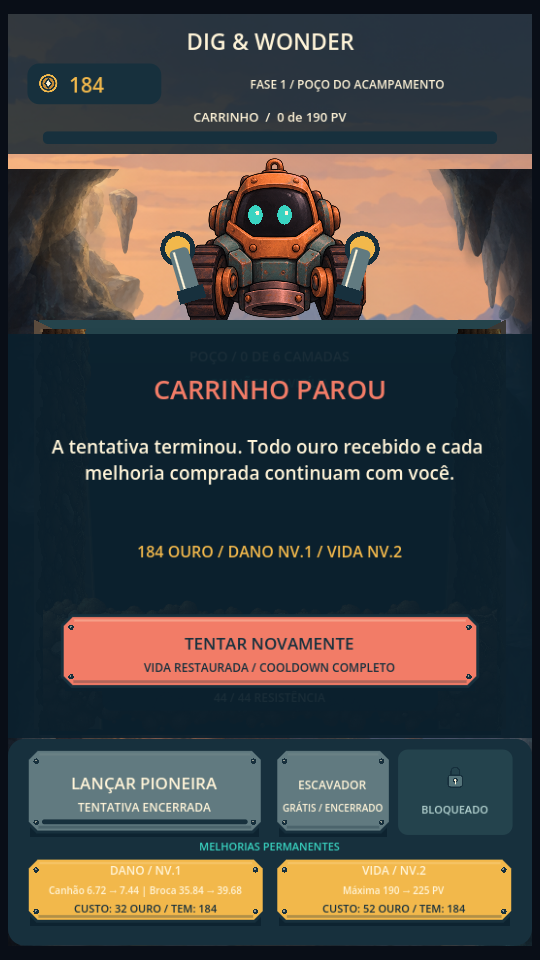
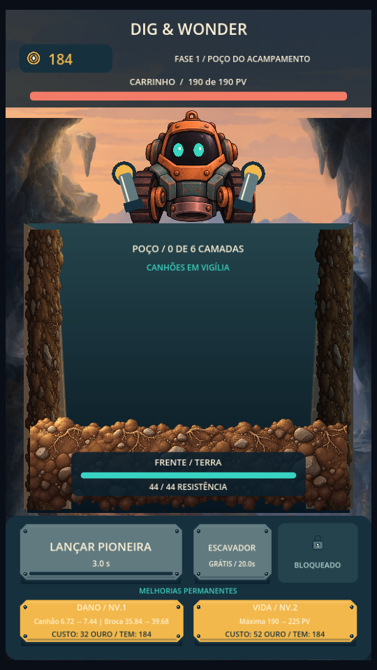

# Capturas reais — 20/10/2026

Desktop Godot, viewport retrato 540×960. Sem mockup ou injeção de ouro/inimigo; persistência bloqueada nos scripts de captura. Não é validação Android.

## Antes da revisão do Marco 1

## Depois da revisão do Marco 1

## Marco 2: animações e apoio

Prévia de 8 s, tempo normal; começa com recarga e mostra os saltos e quebra da primeira Pioneira:

[Gravação completa de 28 s, WebP animado](marco2-completo.webp), 336 quadros a aproximadamente 12 quadros/s. Frequência de captura não é medição de FPS do jogo. Redimensionamento apenas para encoding; screenshots abaixo mantêm 540×960.

Reprodução: `scripts/capture_review.gd` para a revisão, `scripts/capture_marco2.gd` para o estado atual. Para obter exatamente o antes, usar o commit c32fd69 com o script de captura da revisão; depois do Marco 1, ff2ac9a. Capturas originais em builds/review, ignoradas. Limitações: toque real, dp, desempenho, memória/consumo, anúncios e APK não verificados.
